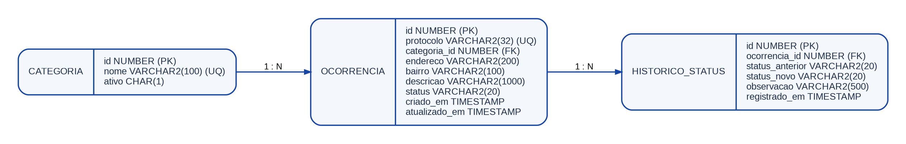

# Diagrama Entidade-Relacionamento (DER) — lógico/físico

**CATEGORIA** (`id` PK NUMBER, `nome` VARCHAR2(100) UNIQUE, `ativo` CHAR(1)).

**OCORRENCIA** (`id` PK NUMBER, `protocolo` VARCHAR2(32) UNIQUE, `categoria_id` FK NUMBER, `endereco` VARCHAR2(200), `bairro` VARCHAR2(100), `descricao` VARCHAR2(1000), `status` VARCHAR2(20), `criado_em` TIMESTAMP, `atualizado_em` TIMESTAMP).

**HISTORICO_STATUS** (`id` PK NUMBER, `ocorrencia_id` FK NUMBER, `status_anterior` VARCHAR2(20) NULL, `status_novo` VARCHAR2(20), `observacao` VARCHAR2(500), `registrado_em` TIMESTAMP).

Restrições de integridade: FK, UNIQUE para protocolo, CHECK para estados e categoria ativa, índices de pesquisa por categoria, status e ocorrência associada ao histórico. IDs são gerados por `IDENTITY`; protocolo usa `seq_protocolo` própria, independente do ID interno.

## Consistência com o aplicativo

O aplicativo grava objetos equivalentes às tabelas `OCORRENCIA` e `HISTORICO_STATUS` em AsyncStorage para permitir execução sem servidor. As categorias ficam fixas no módulo `src/domain/ocorrencias.mjs` e são inseridas na tabela `CATEGORIA` pelo script Oracle. **Os registros do app não são sincronizados com Oracle nesta versão**, e isso deve ser declarado na apresentação.
