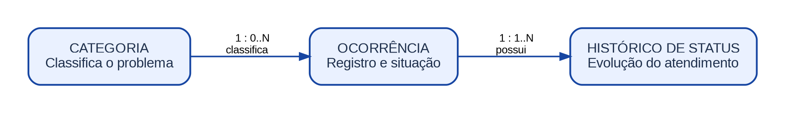

# Modelo Entidade-Relacionamento (MER) — conceitual

## Contexto

O cidadão pode registrar um problema de infraestrutura pública sem se cadastrar no protótipo. A informação armazenada é anônima: endereço do problema, bairro, descrição, categoria, situação e histórico. Não há cadastro de pessoa física e não se coletam CPF, nome, telefone ou geolocalização.

## Entidades

**CATEGORIA**: tipificação do problema; uma categoria pode classificar várias ocorrências.

**OCORRENCIA**: unidade de registro; contém protocolo, descrição, endereço, bairro, situação e datas. Toda ocorrência pertence exatamente a uma categoria.

**HISTORICO_STATUS**: eventos da linha do tempo; cada evento pertence a exatamente uma ocorrência. Uma ocorrência possui um ou mais eventos, sendo o primeiro criado na abertura.

## Relacionamentos e cardinalidades

- CATEGORIA (1) — (0..N) OCORRENCIA: classifica.
- OCORRENCIA (1) — (1..N) HISTORICO_STATUS: possui eventos (a regra de negócio garante o primeiro evento; o banco permite tecnicamente 0 temporariamente).

O MER é o modelo conceitual. O DER especifica atributos, chaves e restrições implementados na versão Oracle.

